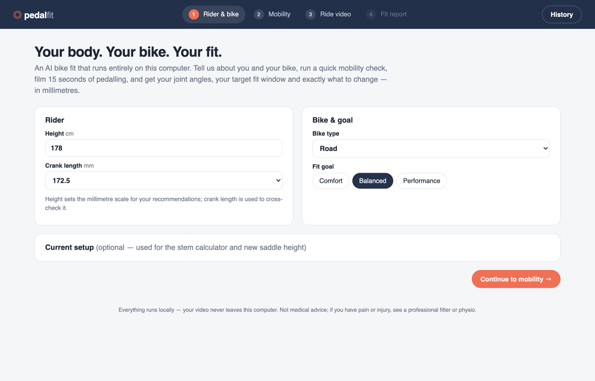
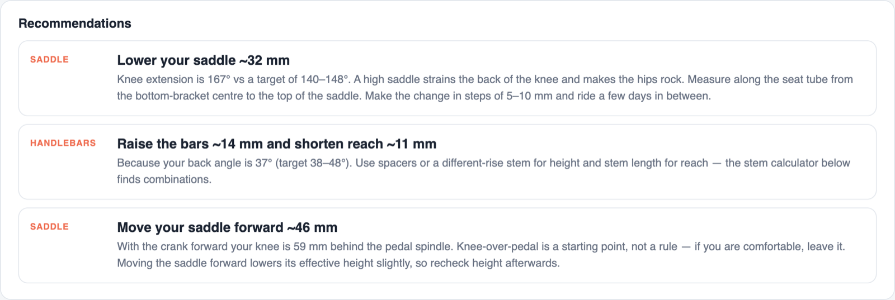
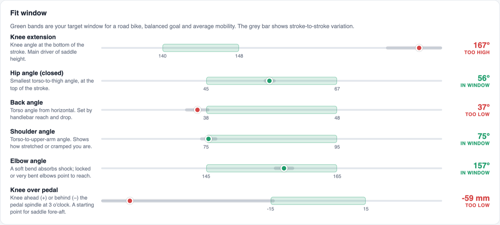
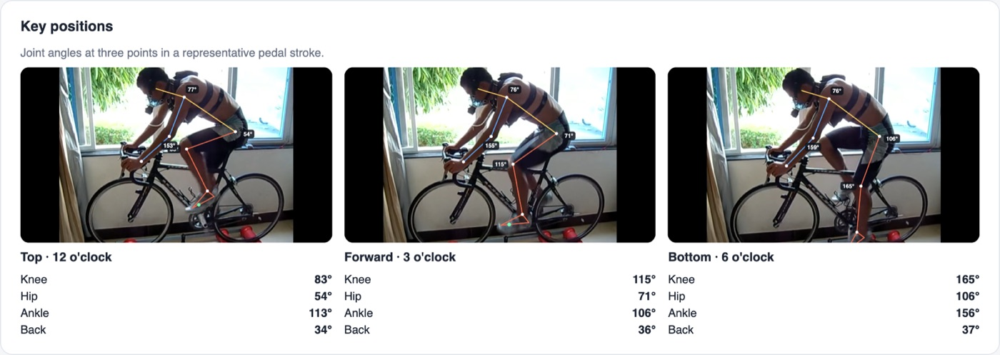
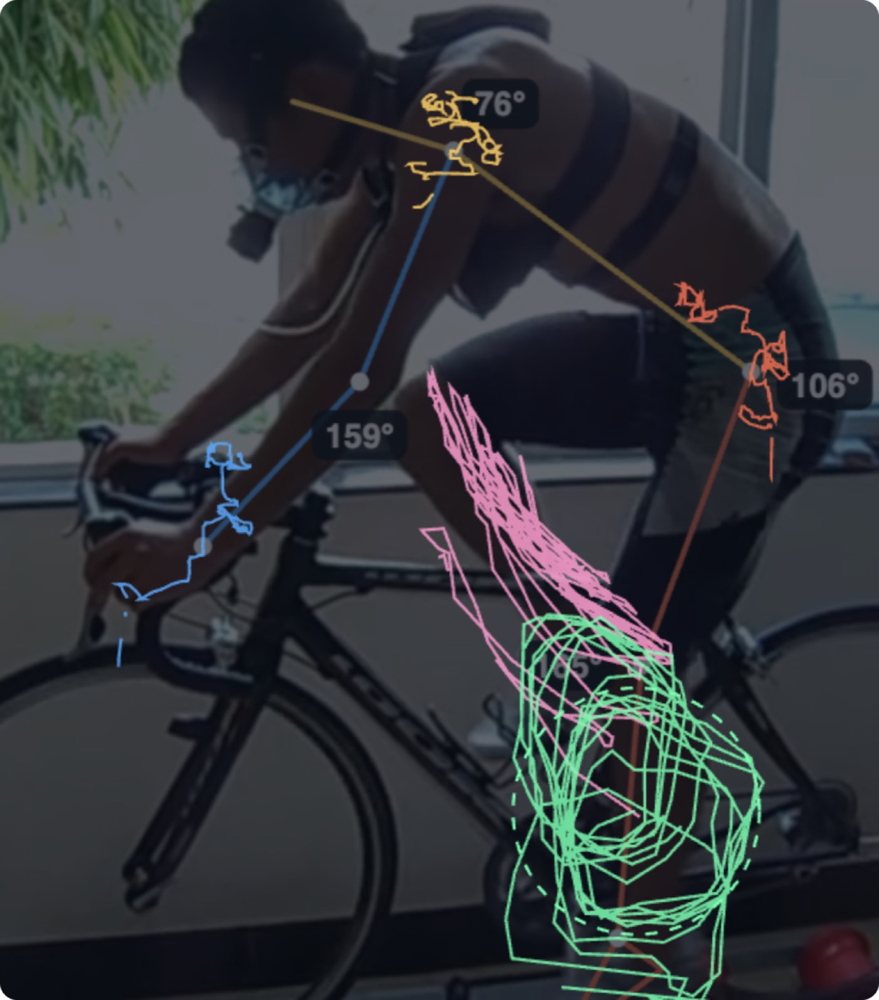
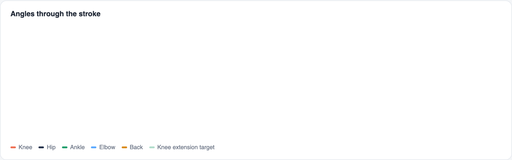
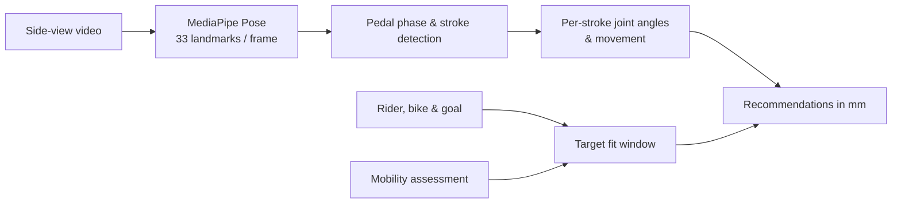

<div align="center">


# pedalfit

**A private AI bike fit that runs entirely in your browser.**
Film 15 seconds of pedalling and get your joint angles, your target fit window and exactly what to change, in millimetres.

[](https://github.com/amith2368/pedalfit/actions/workflows/ci.yml)
[](LICENSE)


[Quick start](#quick-start) · [How it works](#how-it-works) · [The maths](#the-maths) · [Filming tips](#filming-tips) · [Contributing](CONTRIBUTING.md)



</div>

## Why

A professional bike fit costs hundreds and needs an appointment. Online fit apps work well, but they upload your
video to someone else's server. **pedalfit** does the whole job on your own machine. The pose model, the analysis
and the report all run in the browser tab, and nothing is ever uploaded.

## Features

- 🎥 **Video motion capture**: upload a clip or record from your webcam. MediaPipe Pose tracks 33 joints in every frame.
- 📐 **Key joint angles**: knee extension and flexion, closed hip angle, back angle, shoulder, elbow and ankle,
  measured at **12, 3 and 6 o'clock** in each pedal stroke and averaged over every full stroke.
- 🎯 **Personal fit window**: target ranges for **8 bike types** (road, gravel, MTB, tri, TT, hybrid, spin, smart bike)
  × **3 goals** (comfort, balanced, performance), shifted by your **mobility assessment**.
- 🔧 **Recommendations in millimetres**: saddle height, saddle fore-aft, bar height and reach, plus flags for
  rocking hips, upper-body movement, heavy ankling and knee pain.
- 🧮 **Stem calculator**: stem length / angle / spacer combinations that put your bars where they need to be.
- 🦵 **Mobility assessment**: measure your straight-leg raise from a photo with the same pose model.
- 📈 **Joint tracking & charts**: joint paths, angle-vs-time chart, motion replay with a live skeleton.
- 🗂 **History & PDF**: compare fits over time (saved in your browser) and print the report.

<table>
<tr>
<td></td>
<td></td>
</tr>
</table>



<table>
<tr>
<td width="45%"></td>
<td></td>
</tr>
</table>

## Quick start

```sh
git clone https://github.com/amith2368/pedalfit.git
cd pedalfit
python3 server.py          # opens http://localhost:8766
```

That's it: no `npm install`, no build step, no API keys. Python is only used as a static file server. Any static
server works, as long as `.wasm` files are served as `application/wasm`.

Needs a browser with WebGL2 (any current Chrome, Edge, Firefox or Safari).

## How it works



| Step | File | What happens |
|---|---|---|
| 1 | `pose.js` | Steps through the video at 30 fps and runs Pose Landmarker (heavy or full) on each frame |
| 2 | `analysis.js` | Picks the camera-side limbs, fixes near/far leg swaps by motion continuity, drops mistracked frames, fits the ankle's pedal circle to get the crank phase, splits revolutions, takes per-stroke extremes with sub-frame interpolation |
| 3 | `fit.js` | Builds the target window, compares the median of each metric with it, and converts angle gaps into millimetres |
| 4 | `app.js` | Renders the report, snapshots, replay, charts, stem calculator and history |

## The maths

- **Scale.** Pixels → mm come from Winter's anthropometric segment ratios × your height. This is cross-checked
  against the ankle's circle radius vs your crank length; a disagreement above 20% raises a camera-setup warning.
- **Saddle height.** The hip-to-ankle distance at full extension (law of cosines on your thigh and shin lengths)
  changes roughly 1:1 with saddle height along the seat tube, so the target knee angle maps straight to millimetres.
- **Bars.** To reach the target back angle, the shoulders rotate about the hip and the hands move with them, giving
  the reach and stack change. Elbow angle adds the change in shoulder-to-hand span.
- **Robustness.** Values are medians over every full stroke. Stroke-to-stroke spread is shown on each gauge, and
  warnings appear for low tracking, too few strokes, inconsistent strokes or an angled camera.

Target windows follow common fitting practice (Holmes / Retül-style ranges), not any vendor's proprietary numbers.
They live in one table at the top of [`fit.js`](fit.js), so they're easy to tune.

## Filming tips

1. Bike on a trainer (or a smart / spin bike) on level ground.
2. Camera **side-on and square to the bike**, at **hip height**, 2.5–4 m away, in **landscape**.
3. Whole body and both wheels in frame, good light, fitted clothing.
4. Ride in your normal position at a steady 80–90 rpm with some resistance, for at least **15 seconds**.

Angles are measured in 2D, so an angled camera distorts them. The camera position matters more than the model choice.

## Development

```sh
npm test    # node:test suites, Node 20+
```

The tests drive the analysis with a **synthetic rider** of known geometry ([`tests/synthetic-rider.js`](tests/synthetic-rider.js)).
They check that knee extension, back angle, scale and cadence are recovered within tolerance, that both facing
directions work, that the analysis survives pose-model leg swaps, and that saddle and bar recommendations move the
right way by plausible amounts.

```
pedalfit/
├── index.html        UI shell
├── app.js            flow, report rendering, history
├── pose.js           MediaPipe Pose, frame stepping, GPU→CPU fallback
├── analysis.js       landmarks → angles, phase, strokes, metrics
├── fit.js            target windows, recommendations, stem geometry
├── styles.css
├── server.py         static server with correct MIME types
├── tests/            synthetic rider + node:test suites
└── vendor/           MediaPipe runtime and pose models (Apache 2.0)
```

## Disclaimer

pedalfit is a tool for experimenting with your position, not medical advice. If you have pain or an injury, see a
professional bike fitter or physiotherapist. It is an independent project and is not affiliated with any commercial
bike-fit service.

## Credits

- Pose estimation: [MediaPipe Pose Landmarker](https://ai.google.dev/edge/mediapipe/solutions/vision/pose_landmarker)
  by Google (Apache 2.0). See [`vendor/README.md`](vendor/README.md).
- Screenshots are from a video by Yi M, Fu J, Zhou L, et al., "The effect of almond consumption on elements of
  endurance exercise performance in trained athletes", *Journal of the International Society of Sports Nutrition*
  11:18 (2014), [doi:10.1186/1550-2783-11-18](https://doi.org/10.1186/1550-2783-11-18), [CC BY 2.0](https://creativecommons.org/licenses/by/2.0/), via
  [Wikimedia Commons](https://commons.wikimedia.org/wiki/File:The-effect-of-almond-consumption-on-elements-of-endurance-exercise-performance-in-trained-athletes-1550-2783-11-18-S2.ogv).
  The clip is filmed at an angle and is shown for illustration only; its numbers aren't a real fit assessment.

## License

[MIT](LICENSE) © pedalfit contributors
